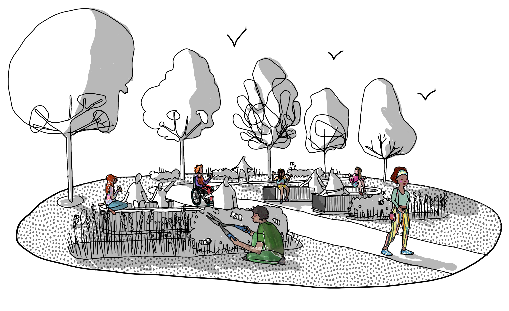

# Welcome to the Safer Parks Dashboard!

[This is a test version of the site ahead of launch to ensure the registration process works smoothly.]{.emphasis}

[Supporting safer, more inclusive parks for women and girls]{.emphasis}

[A free mapping tool that brings together open data and spatial insights to help practitioners understand the factors that shape safety and inclusion in parks across England and Wales.]{.emphasis3}

::::{.grid}

::: {.g-col-12 .g-col-md-6 .align-items-center}

:::::{.larger-bullets}
Use the dashboard to:

- Visualise park safety factors
- Explore spatial data layers
- Make decisions with evidence
- Create safer parks in your area
:::::

:::

::: {.g-col-12 .g-col-md-6 .align-items-center}
{fig-align="center" width="100%"}
:::

::::

::::{.d-flex .justify-content-center}
[Register to access the dashboard](https://forms.cloud.microsoft/Pages/ResponsePage.aspx?id=qO3qvR3IzkWGPlIypTW3y_21PdTtSidAqW-TSzvWOgxUNzlNSDBOWFBSN1JQM0YzUEhYUDdTOE5TNC4u){.btn .btn-primary .btn-lg .rounded-pill}
::::

 

<!-- ::: {.text-box}

[Access the dashboard]{.emphasis}

In order to access the dashboard, you must complete a brief registration form. This allows us to maintain internal records and improve our service.

 

  
Warranty and liability (click to expand)

  The software is provided "as is", without warranty of any kind, express or implied, including but not limited to the warranties of merchantability, fitness for a particular purpose and noninfringement. In no event shall the authors or copyright holders be liable for any claim, damages or other liability, whether in an action of contract, tort or otherwise, arising from, out of or in connection with the software or the use or other dealings in the software.

::: -->

:::{.text-box2}
Grounded in the [*Safer Parks: Improving Access to Women and Girls* guidance](https://eprints.whiterose.ac.uk/id/eprint/229530/1/250908_Safer%20Parks_PCPI_Single.pdf), , the dashboard helps practitioners explore visibility, lighting, access points, route popularity, vegetation, park facilities and surrounding communities across parks in England and Wales.

**[**Launch the dashboard**](https://forms.cloud.microsoft/Pages/ResponsePage.aspx?id=qO3qvR3IzkWGPlIypTW3y_21PdTtSidAqW-TSzvWOgxUNzlNSDBOWFBSN1JQM0YzUEhYUDdTOE5TNC4u) to get started, or visit the [**About**](about.qmd) and [**How to Use**](guide.qmd) pages to learn more.**

  
Warranty and liability (click to expand)

  The software is provided "as is", without warranty of any kind, express or implied, including but not limited to the warranties of merchantability, fitness for a particular purpose and noninfringement. In no event shall the authors or copyright holders be liable for any claim, damages or other liability, whether in an action of contract, tort or otherwise, arising from, out of or in connection with the software or the use or other dealings in the software.

:::

Hero section illustration credit: [Harper Perry](www.harperperry.co.uk).

